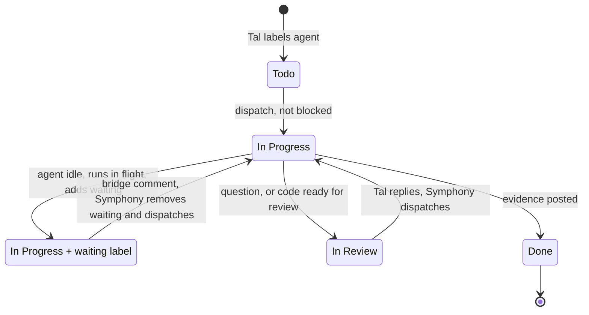
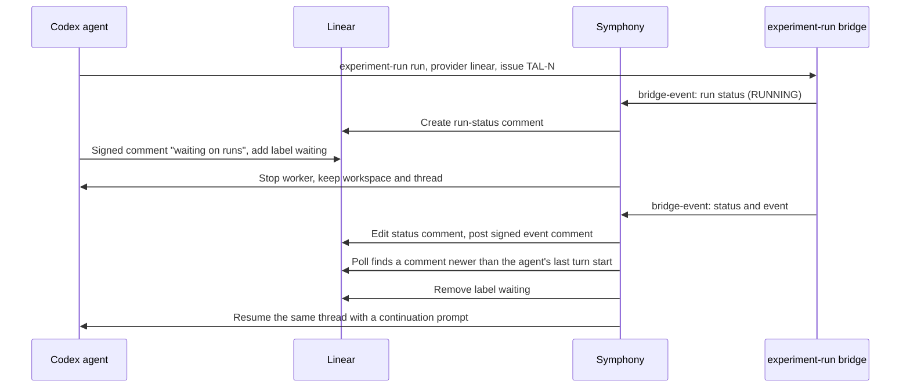

# Plan: our own Symphony for Linear tickets

## Recommendation

Build a Python implementation of OpenAI's Symphony spec that replaces
`run-ticket`. Tal labels a Linear ticket `agent` and walks away. A local service
runs a Codex agent on it in its own workspace, pauses it while an experiment
runs, wakes it when the run changes state, and asks Tal on Linear when it needs
him. Linear is the source of truth. Workers call Claude for independent review
(see [Claude's role](#claudes-role-in-v1)); a Claude worker is a later option.

Interactive work stays in normal Claude and Codex sessions and is out of scope.

Done means every item in the spec's conformance checklist (§18.1) has a passing
test, plus four real trial tickets pass (see
[Verification](#verification-on-real-tickets)).

> [!IMPORTANT]
> Before running, Tal needs to run `symphony login` once (browser OAuth to
> Linear's MCP server). The labels `agent` and `waiting` already exist on TAL;
> no workflow states are added.

## Facts that shape the choice

Observed:

- `openai/symphony` is a spec plus an Elixir reference. Its README calls the
  reference a prototype and recommends implementing your own hardened version
  from `SPEC.md`.
- No hardened third-party implementation exists. The ports (`symphony-ts`,
  `oh-my-symphony`, `Maestro`, forks) are stale or small.
- The spec polls Linear with a personal API key. Tal can't create one (and is
  not an admin), so Symphony polls Linear's MCP server instead
  (`https://mcp.linear.app/mcp`). It supports dynamic client registration,
  public clients and refresh tokens, so Symphony registers as its own OAuth
  client and stores the token in Keychain.
- Tal can't add workflow states. TAL has Backlog, Todo, In Progress, In Review,
  Done, Canceled and Duplicate, and the labels `agent` and `waiting`.
- The spec ships a test matrix (§17) and a conformance checklist (§18.1). That
  is the reliability evidence run-ticket lacked.
- `run-ticket` already talks to the shared Codex daemon (`codex_rpc.py`). Trials
  TAL-169 and TAL-171 completed. TAL-171 woke 34 seconds after its experiment
  finished.

Assumption to check in phase 0:

- The shared daemon can resume a thread started in an earlier dispatch and
  stream its turn events.

Agent and bridge comments post as Tal, so every one starts with a fixed
signature line (see [Comment signatures](#comment-signatures)). A comment
without one is Tal's. Phase 0 still checks whether Linear marks MCP comments
on its own, but the design doesn't depend on it.

Spec copy:
`/private/tmp/claude-501/-Users-tal/ba60180c-9024-4e28-b61e-820417b3b493/scratchpad/symphony-SPEC.md`.
Section numbers below refer to it.

## What we take from Symphony

### Used

| Spec part | How we use it | Why |
|---|---|---|
| §4 domain model | As written | Small, covers our needs |
| §5 `WORKFLOW.md` (YAML front matter + prompt) | As written; our own file | Prompt and config in one versioned file, reloaded live |
| §6 config, `$VAR`, live reload, preflight | As written | Required; cheap |
| §7 orchestration state machine | As written | One authority, no duplicate dispatch |
| §8 polling, selection, concurrency, retry, reconciliation, stall detection | As written | Replaces run-ticket's 60s watcher and `derive()` |
| §9 workspaces, hooks, safety invariants | As written, one safety deviation | Per-ticket isolation; hooks make git worktrees |
| §10 runner: turn loop, continuation turns, `max_turns`, timeouts | As written, transport deviation | Replaces Codex thread goals; Linear state is the done signal |
| §10.2 "create **or resume** a thread" | One thread per ticket across parks | Keeps context across experiment waits |
| §11 Linear adapter: state-list and ID-refresh reads, `dispatchable` | Same interface, MCP transport (deviation 5) | `dispatchable` holds our Linear rules |
| §12 strict prompt rendering | `python-liquid`, strict undefined | Required |
| §13.1–13.5 structured logs, token accounting | JSONL log + CLI status | Required |
| §14 restart recovery from Linear + filesystem | As written | No orchestrator database |
| §15 secrets, hook timeouts, hardening | OAuth token in Keychain, never in agent env | |
| §16 reference algorithms | Followed when writing the loop | Saves design time |
| §17.1–17.7, §18.1 | Our test suite and definition of done | |
| §17.8 real integration profile | Run on trial tickets | |

### Not used

| Item | Why not |
|---|---|
| Elixir reference code | A prototype; Python matches our existing code and the bridge |
| Their sample `WORKFLOW.md` | Skips approvals and merges after "Merging" |
| `linear_graphql` agent tool | Codex already has the Linear MCP over OAuth |
| HTTP dashboard (§13.7) | Optional; CLI and Rex tabs are enough |
| SSH workers (Appendix A) | One laptop |
| Persisted retry queue (§18.2) | We persist only the thread id; retries rebuild from Linear |
| Third-party ports | Stale or small, none hardened |

### Deviations from the spec

1. **Transport (§10.1).** The spec starts `codex app-server` over stdio per
   worker. We connect to Tal's shared Codex daemon so the thread is live in the
   Codex app and Rex. Subprocess mode stays as a config fallback. *Open decision
   1.*
2. **Workspace removal (§9.4).** The spec deletes the workspace even if
   `before_remove` fails. We skip deletion, log it and notify, so a dirty
   worktree is never deleted.
3. **Orchestrator writes to Linear (§11.5).** The spec keeps the orchestrator
   read-only. We add two writes: when Codex escalates an approval or input
   request, post the question and move the ticket to In Review; and when it
   dispatches a woken ticket, remove its `waiting` label or move it from In
   Review to In Progress. Other writes come from the agent (MCP) or the bridge
   (through `symphony bridge-event`).
4. **Hook environment.** Hooks also get `SYMPHONY_ISSUE_IDENTIFIER`, `_ID`,
   `_LABELS` and `_REPO`. Additive.
5. **Tracker transport (§11).** The spec reads Linear over GraphQL with a
   personal API key. We call Linear's MCP server tools (`list_issues`,
   `get_issue`, `list_comments`, `save_comment`, `save_issue`) with the `mcp`
   Python SDK over streamable HTTP, authorized by `symphony login`. Same
   adapter interface.

## How a ticket moves

The ticket state describes what the **agent** is doing, not the experiments.
A ticket can have runs in flight while its agent fixes another run or prepares
analysis; it stays In Progress. Only when the agent has nothing to do until a
run changes state does it add the `waiting` label (the state stays In
Progress). Runs are tracked separately, one run-status comment per run (see
[Experiment flow](#experiment-flow)).

The diagram shows the states, the `waiting` label and what moves the ticket
between them.

### Linear setup (TAL team)

- **Dispatch label** `agent` (`tracker.required_labels`). Nothing else on the
  board runs.
- **Waiting** is the label `waiting` on an In Progress ticket. The agent adds
  it when idle; Symphony removes it when it dispatches the woken ticket.
- **Human review** is the existing state In Review (questions and code ready
  for review).
- **Active states:** Todo, In Progress, In Review.
- **Terminal:** Done, Canceled, Duplicate.
- **`dispatchable` is false when:**
  - any `blocked_by` ticket is not terminal (gives dependency chains);
  - the ticket has the `waiting` label or is in In Review, with no wake
    comment (below);
  - the ticket isn't assigned to Tal.
- So `waiting` and In Review stop the worker and keep the workspace (§8.5,
  "active but not routable"). No tokens burn.
- **Wake rule:** a ticket with the `waiting` label or in In Review becomes
  dispatchable when
  a comment from Tal or the bridge is newer than the **start** of the agent's
  last turn. Symphony records that time in the workspace. Comparing against
  the turn start, not the agent's parking comment, closes the race where a run
  finishes while the agent is mid-turn and about to park: that event still
  wakes it. The cost is at most one extra resume that finds nothing new.
- **Repo:** label `repo:<name>` maps to a path in `WORKFLOW.md`. `after_create`
  runs `git -C $SYMPHONY_REPO worktree add $PWD -b u/tfriedman/<ticket>`. No
  repo label gives a plain directory. `before_remove` runs `git worktree remove`
  without `--force`.

### Claude's role in v1

Workers are Codex only. Claude stays available to them as a tool, not as a
worker:

- **Independent review.** The shared `review` skill already says to review
  substantive work "through the other configured default provider". A Codex
  worker runs Claude headless and read-only for that:
  `claude -p --permission-mode plan` with the fixed revision, objective and
  evidence. The worker posts the review summary on the ticket with the
  reviewer named. This uses Tal's Claude login.
- **Plans and artifacts for Tal.** Codex sees the `markdown-plans` and
  `plannotator` skills, so a worker can write a Markdown plan or report in its
  workspace and open it for review. Publishing a claude.ai Artifact is a
  Claude Code tool Codex doesn't have; a worker doesn't publish one. It leaves
  the file and says so in the ticket, and Tal publishes from a Claude session
  if he wants a link.

The runner contract (§10.7) is engine-neutral, so a Claude runner can be added
later without touching the orchestrator (see [Later](#later)).

### Thread affinity

The first dispatch writes `.symphony/thread.json` in the workspace. Every later
dispatch (after a park, a reply, a retry or a restart) resumes that thread with
a short continuation prompt. Only if resume fails does it start a new thread,
with a ticket comment saying so.

### Experiment flow

Each launch gets one run-status comment on the ticket (first line
`🤖 experiment-run status`: run name, current state, Flyte console or result
path), edited in place. MCP attachments are file uploads, not links with
subtitles, so a comment replaces the attachment. The bridge keeps it current,
so Tal sees every run's state on the ticket whatever the agent is doing. The
status comment never wakes a ticket.

The bridge doesn't talk to Linear itself. Its new `linear` provider runs
`symphony bridge-event --issue TAL-N --json -`, so there is one login and one
token. On each run state change it:

1. edits that run's status comment;
2. on a wake-worthy outcome, posts one signed `🤖 experiment-run` comment with
   the state and evidence summary, keyed by event id so a retry never
   double-posts (Symphony checks for the id before posting).

It never changes the ticket state or labels. What happens next depends on the
agent:

- **Agent working (In Progress):** at the end of its current turn, the
  continuation prompt tells it to read new comments, so it sees the event
  within one turn. Optional later: inject it mid-turn with the app-server's
  steer call if turns run long.
- **Agent waiting:** the comment makes the ticket dispatchable; Symphony
  removes the `waiting` label and resumes the thread.

The sequence shows the waiting case. Nothing runs between the `waiting` label
and the bridge comment.

The bridge's `codex` and `axel` providers stay for Axel sessions.

### Comment signatures

Every comment not written by Tal starts with one line:

- `🤖 agent (Codex, TAL-N)` for the agent, required by the `WORKFLOW.md`
  prompt;
- `🤖 experiment-run` for the bridge's event comments, and
  `🤖 experiment-run status` for its run-status comments (these never wake);
- `🤖 symphony` for the orchestrator's own writes.

The adapter treats an unsigned comment as Tal's. If the agent forgets its
signature, the worst case is a spurious wake: the agent resumes, finds nothing
new and parks again. A test covers that.

### Questions for Tal

The agent posts a signed "Question for Tal:" comment, moves the ticket to In
Review and ends its turn. Tal replies on Linear (phone works). The unsigned
reply makes the ticket dispatchable again. Runs keep going and their bridge
comments also wake the agent, which handles them and returns the ticket to
In Review if the question is still open. `run-ticket answer` goes away.

Agent comments post as Tal, so Linear won't notify him. The service sends a
macOS notification on In Review, Done, failure after retries, and skipped
workspace removal.

### Prompt rules in `WORKFLOW.md`

Ported from run-ticket's instructions:

- Read the ticket and comments. No definition of done: ask.
- Use the work and experiment-execution skills.
- Launch only compute the ticket authorizes. Any new AWS or Baseten resource
  needs a question every time (org rule).
- Code goes in the workspace worktree on the `u/tfriedman/` branch, with tests.
  Draft PR only if asked. Never merge, approve or push to main.
- Milestone comments; proportionate effort.
- Start every comment with the agent signature line.
- Launch through `experiment-run --provider linear`; run status lives in
  comments. Keep working while runs are in flight if there is work (fixes,
  analysis prep). Add the `waiting` label only when idle.
- Questions and code ready for review go to In Review.
- Done only with evidence in a comment, and only with no runs in flight. Code
  changes end at In Review.
- Substantive changes and analyses get an independent Claude review
  (`review` skill, `claude -p --permission-mode plan`) before Done or In
  Review; post the result with the reviewer named.
- Tal's Codex `approvals_reviewer = "auto_review"` stays in force. Anything
  escalated becomes an In Review question. The service never auto-approves.

### Budget and operator surface

- `max_turns` per dispatch (default 20) and a per-ticket token cap (label
  `budget:<n>k` overrides). Hitting the cap: comment and In Review.
- One launchd `KeepAlive` service, replacing `local.run-ticket-watch`. Polls
  every 60 s (MCP rate limits are unknown).
- CLI: `symphony ls`, `open TICKET` (Rex tab running `codex resume`), `logs
  TICKET`, `check`, `login`, `bridge-event`.
- Rex: hidden "symphony" session, one tab per running ticket.

## Reused from existing work

| Piece | Fate |
|---|---|
| `run-ticket/codex_rpc.py` | Reused as the app-server transport |
| run-ticket instructions | Become the `WORKFLOW.md` prompt |
| run-ticket Rex tabs, `open`, macOS notify | Ported |
| run-ticket `derive()`, `runs.json`, goals, `answer`, watcher plist | Dropped |
| experiment-run bridge | Gains the `linear` provider |
| experiment-execution skill | Adds a "waiting on a Linear ticket" paragraph |
| Claude attention hooks | Unaffected |

## Implementation steps

Code lives in `~/dotfiles/agents/symphony/`, worktree on branch
`u/tfriedman/symphony`.

1. **Prereqs and probes (½ session).**
   - Tal: `symphony login` (browser OAuth; token in Keychain service
     `symphony-linear-mcp`). Labels `agent` and `waiting` exist; no states to
     add.
   - Probe: whether Linear marks MCP comments itself (`botActor`, app). Only a
     bonus; signatures work either way.
   - Probe the Linear MCP server with Symphony's own login: the result shapes
     of `list_issues` (is `id` the identifier and `uuid` the UUID; `status`,
     `labels`, `assigneeId`, paging keys `hasNextPage`/`cursor`), `get_issue`
     with `includeRelations` (`relations.blockedBy`), `list_comments` (keys,
     author, order), `save_comment` (returned id), `save_issue` with
     `removeLabels`, `get_user` with `me`, and the "not found" error text.
   - Probe OAuth: the stored token endpoint refreshes without a browser;
     whether refresh tokens rotate (the service and `bridge-event` share the
     Keychain record); access-token lifetime; MCP rate limits at a 60 s poll.
   - Probe Keychain: `security -i` accepts the hex record line, and
     `find-generic-password -w` returns it as text.
   - Probe: daemon `thread/resume` on an older thread, and turn events on the
     socket.
   - Probe the review call from inside a Codex worker: `claude -p` runs under
     Codex's sandbox and `auto_review`, returns, and Tal's Claude hooks don't
     hang it.
2. **Core conformance (1–2 sessions).** Workflow loader, config and reload,
   Linear adapter, workspace manager and hooks, runner, orchestrator. Tests for
   §17.1–17.7 with a fake tracker and fake app-server. Check: every §18.1 item
   maps to a passing test.
3. **Extensions (1 session).** Thread affinity, `waiting` label, wake rule
   (including the mid-turn race and a missing-signature case), deviation 3,
   budget, notifications, CLI, Rex tabs, launchd plist. A test for each.
4. **Bridge `linear` provider (½ session).** In the provider-handoffs worktree,
   with tests: run-status comment create and edit, signed event comment, no
   double post, all through `symphony bridge-event`.
5. **Real integration** (below).
6. **Cutover.** Unload `local.run-ticket-watch`. Keep run-ticket code until two
   real experiment tickets complete through Symphony, then remove it.

Steps 2–4 could themselves run as `agent` tickets through run-ticket, spending
Codex tokens instead of this session.

## Verification on real tickets

- [ ] CPU fixture through `experiment-run` (TAL-171 rerun): `waiting` label,
      bridge wake, Done.
- [ ] Work alongside a run: two fixtures, one short and one long. The agent
      stays In Progress handling the short one's result while the long one runs,
      then waits, then wakes on the long one.
- [ ] Question flow: ticket without a definition of done goes to In Review;
      Tal replies from his phone; the ticket resumes on the same thread.
- [ ] Dependency chain: B blocked by A starts only after A is Done.
- [ ] Review: a small code ticket ends at In Review with a Claude review
      comment naming the reviewer.
- [ ] Restart: kill the service mid-turn; it re-dispatches and resumes the same
      thread.

Recovery if a trial misbehaves: remove the `agent` label (the ticket stops at
the next reconcile) or unload the launchd job. Workspaces and threads are kept.

## Accepted gaps for v1

- Laptop sleep stops polling, the bridge and Codex.
- No phone push beyond Linear's own notifications.
- The agent's Linear MCP can reach any ticket, not just its own. We rely on the
  prompt.
- One machine; `max_concurrent_agents` defaults to 3.

## Open decisions

1. **Transport:** shared daemon (recommended; live view in Codex app and Rex) or
   a stdio subprocess per worker, as the spec says.
2. **Who marks Done:** agent may close experiment and research tickets with
   evidence; code stops at In Review (recommended). Or everything stops at
   In Review.
3. **Names:** labels `agent` and `waiting` (decided 2026-11-15: no new states).

## Later

**Claude worker.** A second runner behind the §10.7 contract using the Claude
Agent SDK on Tal's Claude login: session id kept like the thread id, resume
after waiting, permission mode `auto` with escalations and `AskUserQuestion`
turned into In Review questions. Chosen per ticket by label
(`engine:claude`) or a default in `WORKFLOW.md`, sticky for the ticket's life,
with per-engine concurrency. Known weaker spot: no live interactive view while
running (`claude --resume` copies a running session). Needs its own probes:
Linear connector in headless mode, hooks not blocking turn end, and whether
usage headroom is readable for automatic choice.
